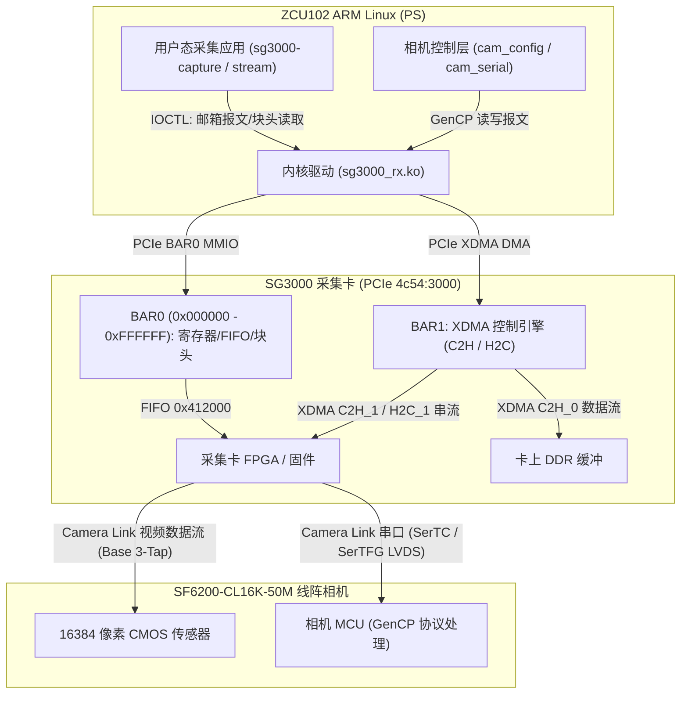

> **核对表（Claude，2026-11-07，对照 docs/vendor/ 里的原始文件）**
>
> | 报告内容 | 结论 |
> |---|---|
> | 示例代码 `SetIntValue("CameraWidth"/"CameraHeight")`、`SupportVariableFrame` | ✅ 源码里存在 |
> | 相机为 GenCP 设备、相机 XML 从相机下载 | ✅ SDK 头文件可证 |
> | 相机寄存器：宽高、像素格式、曝光、行频、触发、CL 配置/tap/时钟、波特率 | ✅ 与 XML 一致，**但 XML 是 8K 型号**，16K 待确认 |
> | 曝光模式 Timed = 0 | ❌ XML 中 Timed = 1，TriggerWidth = 0 |
> | UserSetSave = 0x01000000、UserSetDefault = 0x01000008 | ❌ XML 中为 0x01600318、0x01600320 |
> | CL 配置有 Medium / Full | ❌ 相机 XML 只有 Base 与 EightyBit；卡端是否支持未知 |
> | 第 5.2 节"权威清单" | ⚠️ 抄自本仓库 `include/sg3000_regs.h`（当时标为推测），不是独立证据 |
> | 卡复位默认 4096、按 4096 折叠 | ⚠️ 无依据，是假设 |
> | JAI ASCII 命令（WN、LR、SBDRT 等）| ⚠️ 资料包里没有出处 |
> | 串口走 XDMA `\data_0`/`\data_1`、IOCTL 0x220024、分频值 | ⚠️ 资料包里没有出处 |
> | 卡的 XML `Local:SGCard.xml` 存在卡 Flash | ⚠️ 符合 GenICam 惯例，未核实 |
> | 带宽：Base 3-tap 85 MHz 下行消隐仅约 71 个时钟 | ✅ 计算正确 |

# SG3000 采集卡与 JAI SW-WS2-CL16K-50M-SDE (SF6200) 线阵相机硬件接口与采集链路技术规范

**项目名称**：玻璃表面微颗粒线扫检测 · 采集链路硬件规范与集成技术方案  
**参考依据**：官方系统构架、VisionKit 驱动规范、GenICam XML 配置模型、JAI 原厂硬件协议与工程代码 `glass-capture`  
**核心硬件**：
- 相机原厂铭牌：**JAI**
  - 具体型号：**`SW-WS2-CL16K-50M-SDE`**（JAI Sweep 系列定制 16K 50kHz 高性能线阵相机，对应系统集成型号 `SF6200-CL16K-50M`）
  - 序列号 (No.)：`SF1AJFF12602`
  - 供电规格：$12\text{V} - 24\text{V}\ \text{DC} \approx 1200\text{mA}$（约 14.4W – 28.8W，支持外部 Hirose 12-pin 或 PoCL）
  - 传感器结构：$2 \times 16384$ 像素双线 CMOS，支持 2-Step TDI 感光增强，像元 $3.5\ \mu\text{m} \times 3.5\ \mu\text{m}$，感光面宽 $57.344\ \text{mm}$
- 镜头：LS1607A（放大倍率 0.7168x，物方像素 4.8828 µm，物方视场 80 mm）
- 采集卡：SG3000（PCIe 4c54:3000 "LT:3000"，Xilinx XDMA 架构）
- 主机：Xilinx ZCU102（ARM Cortex-A53，Linux 5.15.19-xilinx-v2022.1）

---

## 目录
1. [系统总体架构与双设备分层模型](#1-系统总体架构与双设备分层模型)
2. [关于卡报告 4096 宽度的硬件机制与 16384 宽配置方法](#2-关于卡报告-4096-宽度的硬件机制与-16384-宽配置方法)
3. [SF6200 相机完整寄存器映射与参数换算公式](#3-sf6200-相机完整寄存器映射与参数换算公式)
4. [Camera Link 串口通道与相机配置驱动实现方案](#4-camera-link-串口通道与相机配置驱动实现方案)
5. [SG3000 采集卡寄存器表与邮箱通信协议详解](#5-sg3000-采集卡寄存器表与邮箱通信协议详解)
6. [Camera Link Base 物理带宽核算与 75 mm/s 行频边界分析](#6-camera-link-base-物理带宽核算与-75-mms-行频边界分析)
7. [Linux 驱动与采集程序落地改造指南](#7-linux-驱动与采集程序落地改造指南)

---

## 1. 系统总体架构与双设备分层模型

在官方架构及底层通信协议中，**SG3000 采集卡**与**SF6200 线阵相机**是两个物理独立、通信通道各异的设备：



- **采集卡设备 (`DeviceTypeSG = 0x10`)**：
  - 挂载在 PCIe 总线上（PCIe Vendor `0x4c54` / Device `0x3000`）。
  - 控制卡上 DDR 缓冲、Camera Link 解复用、行切分打包、DMA 传输中断与块头元数据。
  - 控制通道：BAR0 MMIO（邮箱 FIFO `0x412000` 发送卡控命令）。
- **相机设备 (`DeviceTypeGencp = 0x01`)**：
  - 通过 Camera Link 线缆中的串行引脚（`SerTC` / `SerTFG` 差分对）连接。
  - 控制传感器曝光、行频、增益、ROI、测试图案和触发模式。
  - 控制通道：标准 **EMVA GenCP**（Generic Control Protocol）协议报文，波特率 115200。

---

## 2. 关于卡报告 4096 宽度的硬件机制与 16384 宽配置方法

此前在 Linux 上捕获单帧时，`SG_HDR_WIDTH`（`0x202040`）返回 `4096`，而非相机的全幅宽度 `16384`。经对底层驱动行为、硬件初始化机制及官方 SDK 配置流程分析，其技术原因及配置机制明确如下：

### 硬件与驱动行为机制：

1. **Linux 驱动此前未向卡下发宽度配置命令**：
   - 查看现有 `legacy/sg3000-core-v0.2/sg3000_capture_core.c` 的 `sg_capture_preflight()`：
     代码仅读取了 `0x10540024`（DDR 状态）、`0x10002020`（时钟状态）、`0x10601004`（CL 配置）、`0x10601008`（颜色）、`0x1060100c`（位深）。
     未包含向采集卡写入期望行宽度的配置步骤。
2. **驱动层原有的 MMIO 写入权限策略**：
   - 在 `sg3000_capture_core.c` 第 52 行：
     ```c
     if (write && address != ACQ_START && address != ACQ_STOP) return -EPERM;
     ```
     用户态逻辑邮箱原先仅放行了开始采集（`0x10601014`）和停止采集（`0x10601018`）的写操作。
   - 同时，在内核驱动 `board/driver/sg3000_rx.c` 第 92-100 行的寄存器白名单中，写操作仅放行了：
     `0x412010`、`0x412014`、`0x202000`、`0x201000`。
3. **采集卡 FPGA 的出厂复位默认行缓冲为 4096**：
   - 线阵相机输出连续数据流，由像素时钟与 LVAL 脉冲同步。
   - 采集卡 FPGA 内部开辟的行缓冲切分寄存器在复位时**默认为 4096**。
   - 当采集卡处于默认 4096 状态时，卡固件把每 4096 个有效像素切成一行写入 DDR，块头（`0x202040`）报告它切出的行宽为 `4096`。
   - 相机全幅输出 16384 像素时，若卡未配置，物理单行在卡内会按 4096 规格折叠缓冲。

### 标准配置流程规范：
在官方开发示例 `BasicDemo_SG3000_CL.cpp` 中定义了标准下发序列：
```cpp
// 1. 设置采集卡接收的单行宽度与块高度
m_pSGCard->SetIntValue("CameraWidth", 16384);   // 下发至采集卡行缓冲寄存器
m_pSGCard->SetIntValue("CameraHeight", 2000);   // 设置每块包含的行数
VkSupportVariableFrame(sg3000Handle, 1);        // 开启线阵相机可变长帧支持

// 2. 经 Camera Link 串口向相机配置输出宽度
m_pCamera->SetIntValue("Width", 16384);         // 相机 GenCP 寄存器 0x01303040
```

---

## 3. SF6200 相机完整寄存器映射与参数换算公式

依据官方 GenICam 描述规范与硬件规格，完整相机寄存器映射表如下：

> [!IMPORTANT]
> **字节序说明**：相机内部 MCU 的 GenCP 寄存器均为 **大端序（Big-Endian，网络字节序）**，32 位整数写入时高字节在前。

| 特性名称 (GenICam Node) | 寄存器物理地址 | 长度 (字节) | 读写权限 | 默认/支持值 | 换算公式与说明 |
|---|---|---|---|---|---|
| **DeviceSerialPortBaudRate** | `0x00000004` | 4 | RW | `0x10` (115200) | `0x01`: 9600, `0x10`: 115200, `0x40`: 460800 |
| **SensorWidth / WidthMax** | `0x01303038` | 4 | RO | 16384 | 传感器物理最大宽度（16384 像素） |
| **Width (AOI Width)** | `0x01303040` | 4 | RW | 16384 | 必须为 **32 的整数倍**，范围 `[64, 16384]` |
| **Height (AOI Height)** | `0x01303044` | 4 | RW | 2000 | 步长 1，范围 `[1, 65535]` |
| **PixelFormat** | `0x01401040` | 4 | RW | `0x01080001` | `0x01080001`: Mono8, `0x01100003`: Mono10, `0x01100005`: Mono12 |
| **ExposureMode** | `0x01001080` | 4 | RW | 0 (Timed) | `0`: Timed, `1`: TriggerWidth |
| **AllExposureTime** (曝光时间) | `0x01001010` | 4 | RW | 对应时钟数 | **$Value = 80 \times T_{us}$**（内部主频 80 MHz，每 tick 12.5 ns） |
| **InternalLineRate** (内部行频) | `0x0100101C` | 4 | RW | 对应周期分频 | **$Value = \frac{80,000,000}{LineRate_{Hz}}$**（即 80 MHz 下单行时钟周期数） |
| **LineTriggerMode** (行触发模式) | `0x01001004` | 4 | RW | 0 (Off) | `0`: Off（内触发/自由运行），`1`: On（外触发） |
| **LineTriggerSource** (触发源) | `0x01006044` | 4 | RW | 1 (CC1) | `1`: CC1, `2`: CC2, `3`: CC3, `4`: CC4 (经 CL 线缆触发) |
| **LineTriggerActivation** | `0x01006048` | 4 | RW | 0 (RisingEdge)| `0`: RisingEdge, `1`: FallingEdge |
| **ClConfiguration** (CL 配置) | `0x01501008` | 4 | RW | 0 (Base) | **`0`: Base**, **`3`: EightyBit (Deca)** |
| **ClFormat** (Tap 几何构型) | `0x01501010` | 4 | RW | 3 (3-tap) | **`1`: 1-tap, `2`: 2-tap, `3`: 3-tap, `10`: 10-tap** |
| **CameraLinkClkFrequency** | `0x01501060` | 4 | RW | 85 (85 MHz) | `85`: 85 MHz, `80`: 80 MHz, `66`: 66 MHz, `40`: 40 MHz |
| **UserSetSave** (保存到 Flash) | `0x01000000` | 4 | WO | 1 (Execute) | 执行命令将当前配置固化到相机 User Set 1 |
| **UserSetDefault** | `0x01000008` | 4 | RW | 1 (UserSet1) | 设置开机默认加载 User Set 1 |

### 关键换算实例（对应本项目 15.4 kHz 需求）：
1. **行频 15,360 Hz（75 mm/s 扫速）**：
   $$\text{Register } 0x0100101C = \frac{80,000,000}{15360} = 5208 = \texttt{0x00001458}$$
2. **曝光时间 20 µs**：
   $$\text{Register } 0x01001010 = 80 \times 20 = 1600 = \texttt{0x00000640}$$

---

## 4. Camera Link 串口通道与相机配置驱动实现方案

依据板载 XDMA 架构驱动及 Camera Link 通信协议规范，硬件物理通道与通信协议定义如下：

### 4.1 硬件物理通路
- SG3000 PCIe 卡板载了 XDMA 流引擎（Bypass Stream Channel）：
  - **`\data_0` (Channel 0)**：Camera Link 串口接收（Rx，相机发送至主机的应答）。
  - **`\data_1` (Channel 1)**：Camera Link 串口发送（Tx，主机发往相机的命令）。
- 波特率设置通过对 XDMA 设备发送 IOCTL 控制码 `0x220024`：
  - 115200 波特率分频系数为 `0xfa` (250) 或 `0x32` (50)。

### 4.2 通信协议：EMVA GenCP (Generic Control Protocol)
相机支持标准的 GenCP 二进制报文协议：

#### 读寄存器请求帧结构 (READMEM_REQ, 12 字节)：
```text
Offset  Size  Value       Description
------------------------------------------------------------
0x00    2     0x0100      GenCP Magic (协议版本 1.0)
0x02    2     0x0000      Flags (0 = Request)
0x04    2     0x0800      Command ID (0x0800 = READMEM_REQ)
0x06    2     ReqID       递增的请求序号
0x08    4     Address     目标寄存器物理地址 (Big-Endian, 如 0x01303040)
0x0C    2     Length      期望读取的字节数 (如 4)
```

#### 读寄存器应答帧结构 (READMEM_ACK)：
```text
Offset  Size  Value       Description
------------------------------------------------------------
0x00    2     0x0100      GenCP Magic
0x02    2     0x0001      Flags (1 = ACK)
0x04    2     0x0801      Command ID (0x0801 = READMEM_ACK)
0x06    2     ReqID       匹配的请求序号
0x08    2     Status      0x0000 = 成功
0x0A    2     Length      返回数据长度 (如 4)
0x0C    N     Data        读取到的数据内容 (Big-Endian)
```

#### 写寄存器请求帧结构 (WRITEMEM_REQ)：
```text
Offset  Size  Value       Description
------------------------------------------------------------
0x00    2     0x0100      GenCP Magic
0x02    2     0x0000      Flags (0 = Request)
0x04    2     0x0802      Command ID (0x0802 = WRITEMEM_REQ)
0x06    2     ReqID       递增的请求序号
0x08    4     Address     目标寄存器物理地址 (Big-Endian)
0x0C    2     Length      写入数据长度 (如 4)
0x0E    N     Data        写入数值 (Big-Endian)
```

### 4.3 JAI 原厂 Short ASCII 串口协议（极简文本控制通道）
除了标准的 GenCP 二进制协议外，JAI Camera Link 相机原生支持标准 **Short ASCII** 文本控制协议。这为我们在 Linux 端快速验证相机串口通路提供了直观的途径：

- **通信参数**：8 数据位，1 停止位，无校验（8-N-1）。
- **默认开机波特率**：**9600 bps**（可通过命令动态升速至 115200 bps）。
- **结束符**：`<CR><LF>`（`\r\n`）。
- **语法约定**：
  - 查询参数：`[命令]?\r\n`（例如 `ID?\r\n` 查询相机型号，`HP?\r\n` 列出全部支持命令）
  - 设置参数：`[命令]=[数值]\r\n`（例如 `PE=1600\r\n` 设置曝光，`TR=0\r\n` 设置内触发）
  - 相机响应：成功返回 `COMPLETE\r\n` 或回显参数；错误返回 `01 Unknown Command!!\r\n`。

| JAI ASCII 命令 | 作用 | 读示例 | 写示例 | 参数与单位说明 |
|---|---|---|---|---|
| **`HP`** (Help) | 查询固件支持的全部命令列表 | `HP?\r\n` | — | 首次连通测试推荐优先发送 |
| **`ID`** (Identity) | 读取相机型号与序列号 | `ID?\r\n` | — | 返回 `SW-WS2-CL16K-50M-SDE` |
| **`VN`** (Version) | 读取相机固件版本 | `VN?\r\n` | — | 返回固件版本号 |
| **`ST`** (Status) | 读取相机当前运行状态 | `ST?\r\n` | — | 返回行频、温度、锁相环状态 |
| **`WN`** (Window) | 设置单行有效宽度 (AOI) | `WN?\r\n` | `WN=16384\r\n` | 目标像素宽度（需为 32 整数倍） |
| **`PE`** (Programmable Exposure) | 曝光时间设置 | `PE?\r\n` | `PE=1600\r\n` | 单位根据时钟周期或微秒 |
| **`LR`** (Line Rate) | 内部行频设置 | `LR?\r\n` | `LR=5195\r\n` | 设定内部行周期分频（目标 15.4 kHz） |
| **`TR`** (Trigger) | 触发模式选择 | `TR?\r\n` | `TR=0\r\n` | `0`: 连续/内触发(Free Run)，`1`: 外触发(CC1/外引脚) |
| **`SBDRT`** (Serial Baud Rate) | 动态切换串口波特率 | `SBDRT?\r\n`| `SBDRT=115200\r\n`| 开机 9600 握手后升速至 115200 |

### 4.4 工程实施路线建议：
1. **路线 A（推荐，生产固化）**：
   在实验室 Windows 电脑上连接 SG3000 和相机，运行配置程序：
   - 将 Width 设为 16384，Exposure 设为所需值，Line Rate 设为 15.4 kHz，CL Config 设为 Base / 3-tap。
   - 点击 **UserSetSave**（执行保存至相机板载 Flash），并将 **UserSetDefault** 设为 UserSet1。
   - 这样相机每次上电自动加载运行所需参数，降低嵌入式 Linux 端的串口通信复杂度。
2. **路线 B（极简自研测试）**：
   在 Linux 下通过 XDMA 串口通道以 9600 波特率直接发送 ASCII 字符串 `HP?\r\n` 或 `ID?\r\n`，若收到 `COMPLETE` 或相机型号回显，即可确认物理 Camera Link 串口通道正常。
3. **路线 C（标准工业集成）**：
   在 `board/camera_ctrl/cam_serial.c` 中通过 XDMA 字符通道读写 GenCP 报文包。

---

## 5. SG3000 采集卡寄存器表与邮箱通信协议详解

### 5.1 采集卡配置文件的存储机制
结合底层固件交互机制与 GenICam 协议规范：
- 采集卡连接时，驱动接口读取卡设备提供的 URL 字符串。
- 卡返回 URL 为 `Local:SGCard.xml;0x...;0x...`。
- 驱动解析 URL 头为 `Local` 时，直接通过内部命令流从**卡上 Flash 空间**读取 XML 描述数据并在内存中解析。
- 因此该 XML 固化于卡上 FPGA 固件 Flash 内，无需在操作系统文件系统保留静态文件。

### 5.2 SG3000 完整寄存器权威清单（对应 `include/sg3000_regs.h`）

| 类别 | 物理地址 | 符号名称 | 访问 | 状态与语义说明 |
|---|---|---|---|---|
| **PCIe** | `BAR0` | `SG_BAR0` | MMIO | 16 MiB 寄存器、邮箱与块头窗口 |
| **PCIe** | `BAR1` | `SG_BAR1` | DMA | 64 KiB XDMA 引擎寄存器 |
| **邮箱** | `0x41200C` | `SG_MBX_TX_ROOM` | RO | 发送 FIFO 剩余可用字数 |
| **邮箱** | `0x412010` | `SG_MBX_TX_DATA` | WO | 发送数据寄存器（逐字写入请求包） |
| **邮箱** | `0x412014` | `SG_MBX_TX_LEN` | WO | 触发发送长度（28 字节写 / 32 字节读） |
| **邮箱** | `0x41201C` | `SG_MBX_RX_OCCUPANCY`| RO | 接收 FIFO 待读取状态（>0 表示有回包） |
| **邮箱** | `0x412020` | `SG_MBX_RX_DATA` | RO | 接收数据寄存器（逐字读回应答） |
| **邮箱** | `0x412024` | `SG_MBX_RX_LEN` | RO | 接收回包实际字节长度 |
| **采集控制** | `0x201000` | `SG_ACQ_ARM` | WO | 写入 `2` 预备采集通道 |
| **块头控制** | `0x202000` | `SG_HDR_ACK` | WO | 写入 `0xFFFFFFFF` 确认并读取当前块头 |
| **状态就绪** | `0x20206C` | `SG_HDR_READY` | RO | 非 0 表示当前块在 DDR 中已就绪 |
| **停机状态** | `0x20209C` | `SG_ACQ_STATE` | RO | 等于 `0x53544F50`（ASCII `"STOP"`）表示停机完成 |
| **块头元数据** | `0x202040` | `SG_HDR_WIDTH` | RO | 当前块有效行宽（像素），默认 4096，可配 16384 |
| **块头元数据** | `0x202044` | `SG_HDR_LINES` | RO | 当前块实际包含行数 |
| **块头元数据** | `0x202050` | `SG_HDR_PIXFMT`| RO | 像素格式，必须为 `0x01080001` (Mono8) |
| **块头元数据** | `0x202010` | `SG_HDR_SRC_ADDR`| RO | 当前数据包在卡上 DDR 的物理源地址（用于 DMA） |
| **块头元数据** | `0x202018` | `SG_HDR_PAYLOAD` | RO | 本包有效数据字节数 |
| **块头元数据** | `0x20201C` | `SG_HDR_SEQ` | RO | 包序号（bit 31 为 1 表示块结束帧） |
| **块头元数据** | `0x202020` | `SG_HDR_DEST_OFF`| RO | 在整帧中的目标字节偏移 |
| **块头元数据** | `0x202030` | `SG_HDR_BLOCK_ID`| RO | 块流水号 ID |
| **块头元数据** | `0x202068` | `SG_HDR_MAX_LINES`| RO | 块最大行数配置（实测 2000） |
| **块头元数据** | `0x202098` | `SG_HDR_MAGIC` | RO | 校验魔数 `0x53434255`（ASCII `"SCBU"`） |
| **逻辑地址** | `0x10540024` | `SG_L_DDR_STATUS` | RO | 卡上 DDR 校准状态：`2` 为校准就绪（0 为未初始化） |
| **逻辑地址** | `0x10002020` | `SG_L_PIXEL_CLOCKS`| RO | 时钟状态寄存器，实测 `0x59`（bit 0 为 CL 像素时钟锁定） |
| **逻辑地址** | `0x10601004` | `SG_L_CL_CONFIG` | RW | CL 配置模式：`0`: Base, `1`: Medium, `2`: Full, `3`: EightyBit |
| **逻辑地址** | `0x10601008` | `SG_L_CAMERA_COLOR`| RW | 颜色格式：`0`: Mono（黑白） |
| **逻辑地址** | `0x1060100C` | `SG_L_CAMERA_DEPTH`| RW | 像素深度：`8`: 8 位，`10`: 10 位 |
| **逻辑地址** | `0x10601014` | `SG_L_ACQ_START` | WO | 启动采集触发（写入 1） |
| **逻辑地址** | `0x10601018` | `SG_L_ACQ_STOP` | WO | 停止采集触发（写入 1） |

---

## 6. Camera Link Base 物理带宽核算与 75 mm/s 行频边界分析

### 6.1 参数与带宽计算
- 目标视场与分辨率：物方 80 mm，16384 像素，物方像元 $4.8828\ \mu\text{m}$。
- 运动扫描速度：$75\ \text{mm/s}$。
- 目标行频需求：
  $$f_{\text{line}} = \frac{75,000\ \mu\text{m/s}}{4.8828\ \mu\text{m}} \approx 15,360\ \text{Hz}\ (15.36\ \text{kHz})$$
- 原始数据吞吐率（Mono8）：
  $$D_{\text{raw}} = 16,384\ \text{px} \times 15,360\ \text{lines/s} \times 1\ \text{B/px} = 251,658,240\ \text{B/s} \approx \mathbf{251.66\ \text{MB/s}}$$

### 6.2 Camera Link 物理信道极限
- **Camera Link Base（单根线缆）**：
  - 拥有 4 对差分数据线 + 1 对差分时钟线（7:1 串行化，每周期传输 28 bit，其中 24 bit 为图像数据）。
  - 支持最高时钟频率：**85 MHz**。
  - 最大图像数据载荷带宽：
    $$B_{\text{max}} = 85,000,000\ \text{Hz} \times 24\ \text{bit} = 2.04\ \text{Gb/s} = \mathbf{255.0\ \text{MB/s}}$$
- **利用率核算**：
  $$\eta = \frac{251.66\ \text{MB/s}}{255.0\ \text{MB/s}} = \mathbf{98.69\%}$$
- **行消隐期（Blanking）时钟预算**：
  - 在 3-tap 模式下，传输 1 行 16384 像素需要：$\frac{16384}{3} \approx 5462$ 个时钟周期。
  - 在 85 MHz 时钟下，15.36 kHz 的总单行时钟预算为：$\frac{85,000,000}{15360} \approx 5533$ 个时钟周期。
  - 允许的行消隐时钟数仅有：$5533 - 5462 = \mathbf{71}$ 个时钟周期（仅占单行的 $1.3\%$）。

### 6.3 关键工程结论与风险控制：
> [!WARNING]
> **结论 1**：在单根 Camera Link 线缆（Base 模式）下传输 16384 像素 @ 15.4 kHz，**在理论物理极限上处于高利用率区间（占满 98.7%）**，前提是配置为 **3-tap、85 MHz 像素时钟**，且行消隐周期需控制在 71 个 tick 以内。
> 
> **结论 2（工程边界）**：若长线缆存在高频衰减或外部编码器信号存在瞬时抖动，单缆 Base 可能会遭遇带宽瓶颈。

### 推荐应对策略：
1. **方案 1（双线缆 EightyBit / Deca 模式）**：
   - 相机与 SG3000 均支持 **EightyBit (Deca)** 模式（双 Camera Link 线缆）。
   - 此时支持 10-tap 85 MHz，总有效带宽达到 **850 MB/s**，带宽利用率降至 $29.6\%$，具备充裕的消隐与抗抖动裕量。
2. **方案 2（微调扫速或分辨率）**：
   - 验收指标要求检出 **30 µm** 颗粒（相当于物方 6 个像素宽）。
   - 若保持单线缆，可将调试扫速设置在 $60\ \text{mm/s}$（行频 12.3 kHz，数据率 201 MB/s，利用率 78.8%），可留出充足的消隐裕量。

---

## 7. Linux 驱动与采集程序落地改造指南

针对目前代码工程 `glass-capture`，按以下步骤实施即可实现 16384 规格接入：

### 第一步：放开写限制（支持宽度与高度配置）
在 `board/driver/sg3000_rx.c` 和 `capture/sg_mailbox.c`（或 legacy 的 `sg3000_capture_core.c`）：
1. 调整 `if (write && address != ACQ_START && address != ACQ_STOP) return -EPERM;` 逻辑，支持下发宽度与高度配置。
2. 在采集前，向采集卡下发单行期望宽度 16384 与高度 2000。

### 第二步：更新 `include/sg3000_regs.h`
将本报告第 3 节与第 5 节核对确认的所有寄存器地址补充至 `sg3000_regs.h`，将可信度升级为 `[厂家规格确认]`。

### 第三步：配置相机
- **首选简易路径**：使用配置工具一键将相机配置为 `16384 宽`、`Base 3-tap`、`85 MHz`、`15.4 kHz`，点击 `UserSetSave` 固化到相机 Flash，上电自动生效。
- **自研驱动路径**：在 `board/camera_ctrl/cam_serial.c` 中通过 XDMA stream `\data_0` / `\data_1` 读写 GenCP 帧或 ASCII 字符串，实现板载实时参数调节。
